<p align="center">
  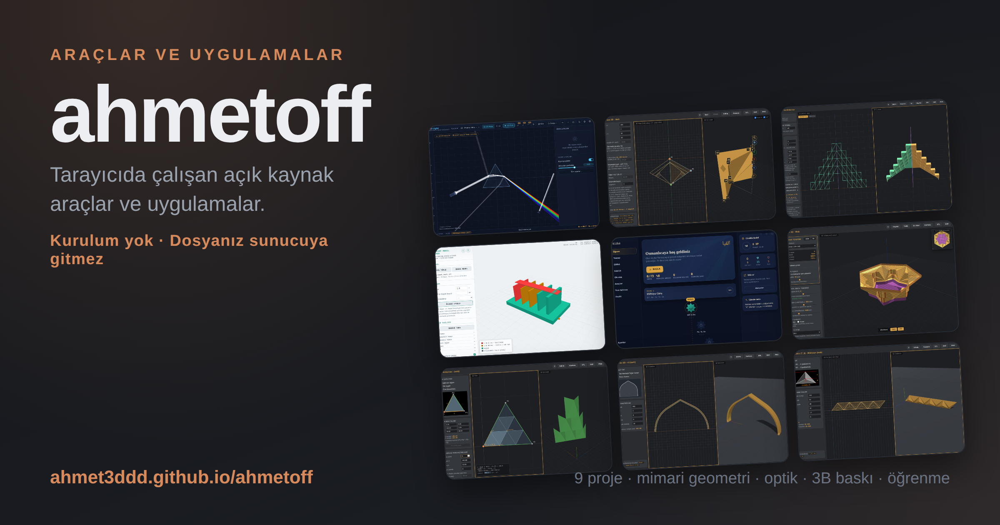
</p>

<h1 align="center">ahmetoff</h1>

<p align="center">
  Tarayıcıda çalışan açık kaynak araçlar.<br/>
  Hiçbiri kurulum istemez, hiçbiri dosyanızı bir sunucuya göndermez.
</p>

<p align="center">
  <a href="https://ahmet3ddd.github.io/ahmetoff/"></a>
  
  
</p>

<p align="center">
  <strong>▶ Canlı site: https://ahmet3ddd.github.io/ahmetoff/</strong>
</p>

---

## İçindekiler

| Bölüm | Projeler |
|---|---|
| **[Mimari Geometri](#mimari-geometri)** | Mukarnas 3D · Köşe Mukarnas · Niş Mukarnas · Püskül 3D · Kemerler 3D · Revzen 3D · Yedi-Sekiz |
| **[Üretim ve Analiz](#üretim-ve-analiz)** | AI Light · 3D Print Model Kontrol |
| **[Öğrenme](#öğrenme)** | Elifbâ — Osmanlıca Öğren |

---

## Mimari Geometri

Geleneksel mimari formları parametrelerle modelleyen araçlar. 2B plan ve 3B görünüm eş zamanlı çalışır; sonuç **DXF**, **STL** veya **PNG** olarak dışa aktarılır. 3B görselleştirme [Three.js](https://threejs.org) ile yapılır.

### Mukarnas 3D `v3`
Mukarnas (sarkıt tavan süslemesi) hücrelerini — Badem, Yaprak, Fitil, Kaz Ayağı — parametrik olarak 3B modeller. Çizim ve düzenleme modları, plan üçgeni girişi, otomatik asaba hesabı.

**v3'te yeni:** **Yaprak** tipinde Düzenleme modundaki A–F yükseklik ayarları yanlış köşeleri taşıyordu. Segment listeleri kaynak (weld öncesi) köşe indekslerine göre yeniden yazıldı; artık her segment yalnızca kendi üst Z kademesindeki köşeleri taşıyor, ayna tarafı da birlikte hareket ediyor.

**v2'de gelen:** 7–8 ve 16–17 kenarlarına yay şeklinde **fillet** uygulanabiliyor; yay yan duvarlara yatırılıp komşu yüzeyler yeniden örülüyor.

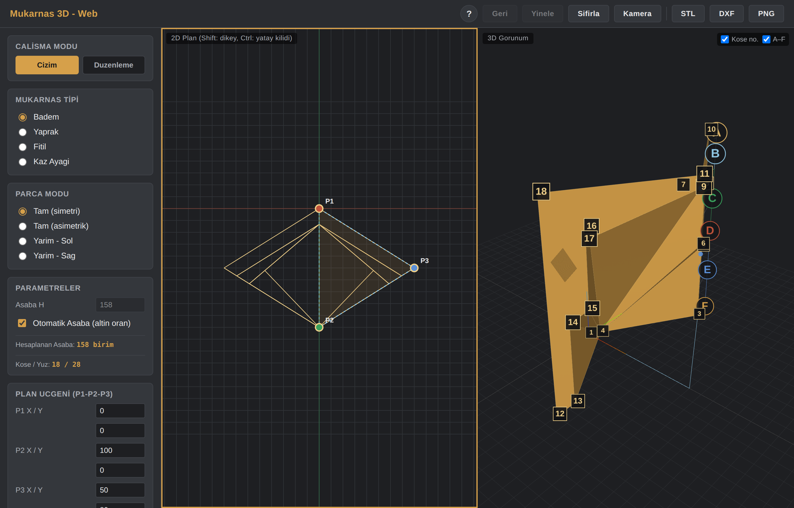

[▶ Aç (v3)](https://ahmet3ddd.github.io/ahmetoff/projects/AI_muk3d_V3/) · [Kaynak](projects/AI_muk3d_V3)

<sub>Önceki sürümler: [v2'yi aç](https://ahmet3ddd.github.io/ahmetoff/projects/AI_muk3d_V2/) ([kaynak](projects/AI_muk3d_V2)) — fillet var, Yaprak düzenleme hatası da var · [v1'i aç](https://ahmet3ddd.github.io/ahmetoff/projects/AI_muk3d/) ([kaynak](projects/AI_muk3d)) — fillet öncesi hâli. İkisi de çalışır durumda korunuyor.</sub>

### Köşe Mukarnas
Köşe mukarnaslarını üçgen plan (P1-P2-P3) üzerinden kurgular. Eşkenar/dik üçgen veya özel koordinat şablonu; asaba sayısı arttıkça plan alt hücrelere bölünüp form kademelenir.

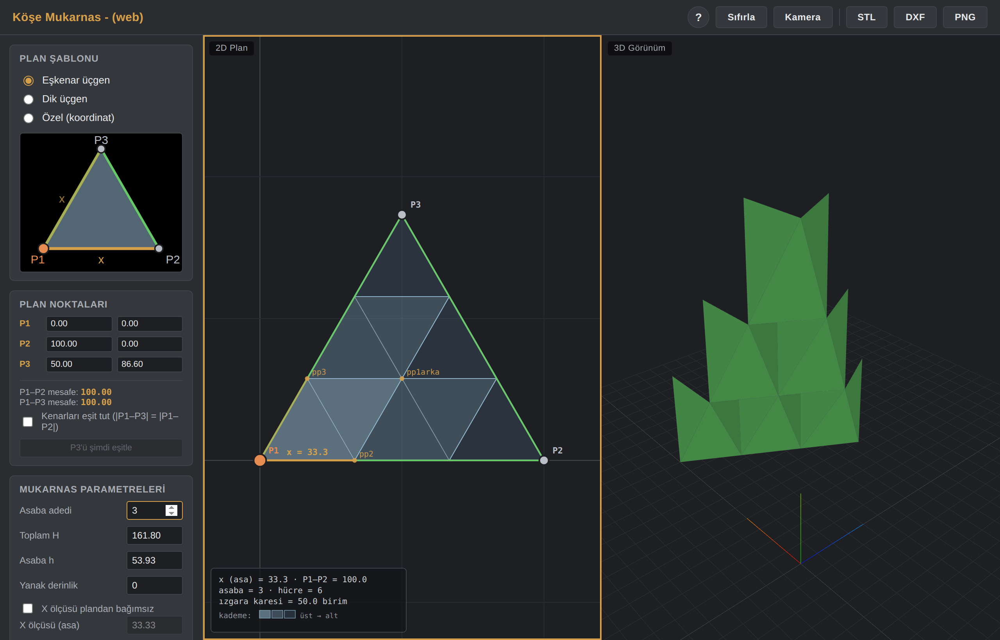

[▶ Aç](https://ahmet3ddd.github.io/ahmetoff/projects/AI_K_muk3d/) · [Kaynak](projects/AI_K_muk3d)

### Niş Mukarnas
Niş (kavsara) mukarnaslarını tek bir açıklık ölçüsüyle kurgular: asaba ve sıra adedine göre hücreler kademelenir, X = 0 düzleminde aynalanan simetri modülüyle form tamamlanır.

Yükseklik ve derinlikte çift yönlü ölçü mantığı vardır — *asaba h* ile *toplam H*'den hangisini girerseniz o belirleyici olur, diğeri ondan türetilir; derinliğe 0 girilirse otomatiğe döner. Altın oran seçeneği asaba yüksekliğini asa ölçüsünün φ ≈ 1,618 katına sabitler. Sıra adedi asaba adedinden azken arkada kalan açıklık tek parça duvarla kapatılır; yanak derinliği verildiğinde düşey yanak yüzeyleri üretilir.

DXF çıktısı üç katman içerir: `MUK_3D` (3DFACE), `MUK_ELEV` (görünüş), `MUK_PLAN` (plan). Three.js uygulamanın içinde geldiği için çevrimdışı çalışır.

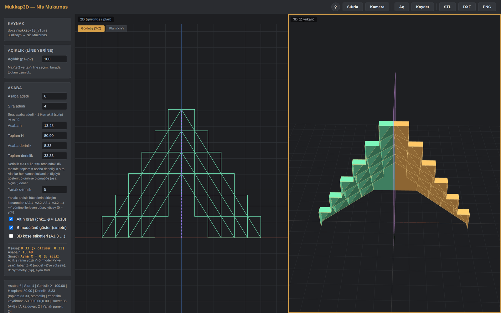

[▶ Aç](https://ahmet3ddd.github.io/ahmetoff/projects/AI_N_muk3d/) · [Kaynak](projects/AI_N_muk3d)

### Püskül 3D
Mukarnas püskül (sarkıt) yapılarını çok katmanlı modeller. Katman yönetimi, hücre tipi atama, katmanlar arası geçiş yüzeyleri ve JSON kaydet/yükle.

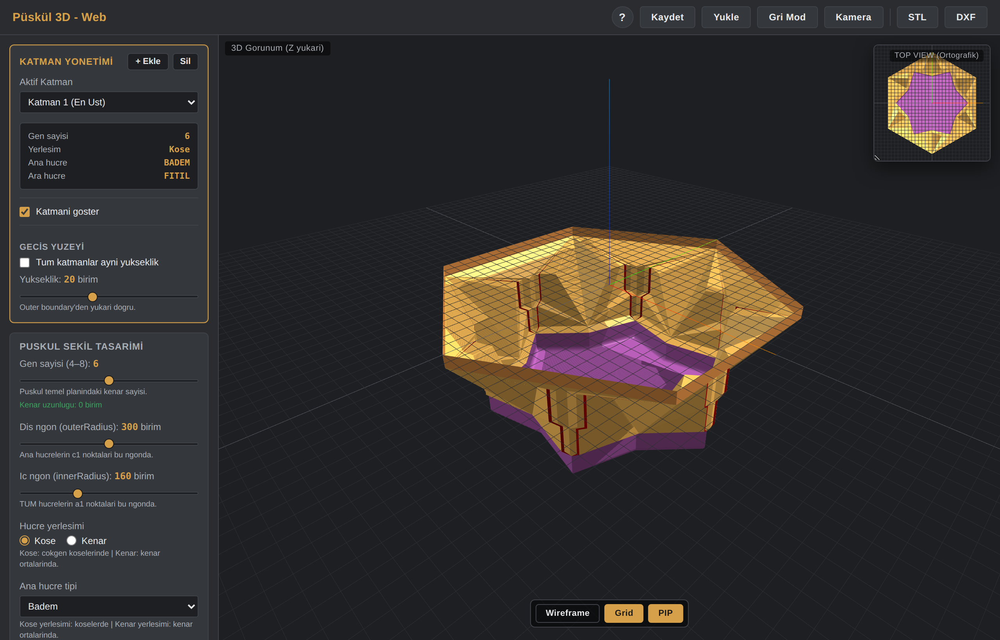

[▶ Aç](https://ahmet3ddd.github.io/ahmetoff/projects/AI_Puskul/) · [Kaynak](projects/AI_Puskul)

### Kemerler 3D
Tek Merkezli Teğet ve Penci kemer tiplerini parametrelerle 3B modeller.

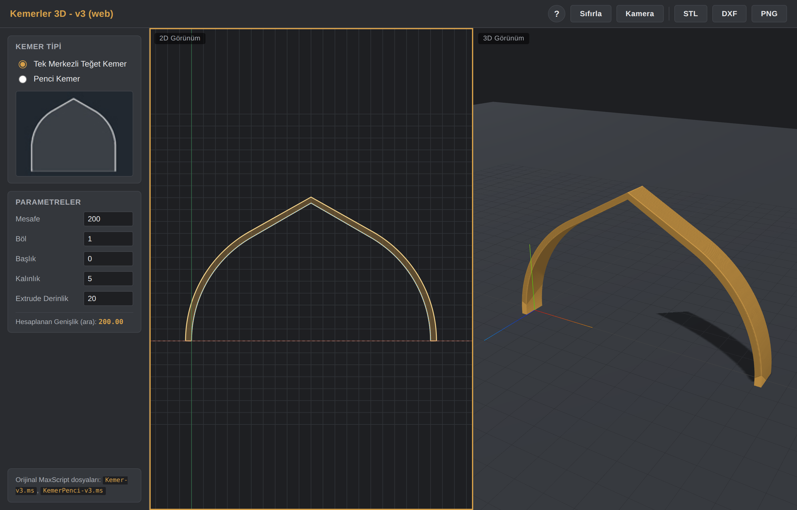

[▶ Aç](https://ahmet3ddd.github.io/ahmetoff/projects/AI_Kemer/) · [Kaynak](projects/AI_Kemer)

### Revzen 3D
Revzen-i menkûş — alçı ya da taş levhaya açılan gözlerin renkli camlarla doldurulduğu Osmanlı penceresi. Kemer profilini ve göz dizilimini parametrik olarak üretir.

Beş pencere tipi: **Tam Kemerli (DK)**, **T.M.T. Kemerli** (tek merkezli teğet), **Penci Kemerli** (iki merkezli), **Dairesel** (oculus) ve **Düz**. Göz formu **daire** ya da **filgözü**; filgözünün kurgusu T.M.T. kemerin aynalanmış hâlidir ve referans oranı **√2**'dir — teğet noktası tam 45°'te durduğu için `Boy/En = 1/sin 45°` çıkar. Satır adımı, çapraz komşuyla arada da aynı alçı kalınlığı kalacak şekilde çözülür — bant her yönde eşittir.

Çerçeve ve panel derinlikleri ayrı verilir; çıktı **STL**, **DXF** veya **PNG**, proje JSON olarak saklanır.

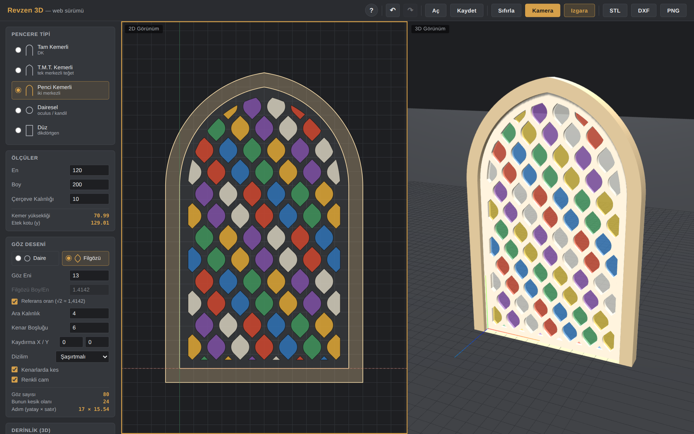

[▶ Aç](https://ahmet3ddd.github.io/ahmetoff/projects/AI_Revzen/) · [Kaynak](projects/AI_Revzen)

### Yedi-Sekiz (7-8)
Geleneksel yedi-sekiz geçme desenlerini V8 tipi parametrelerle üretir.

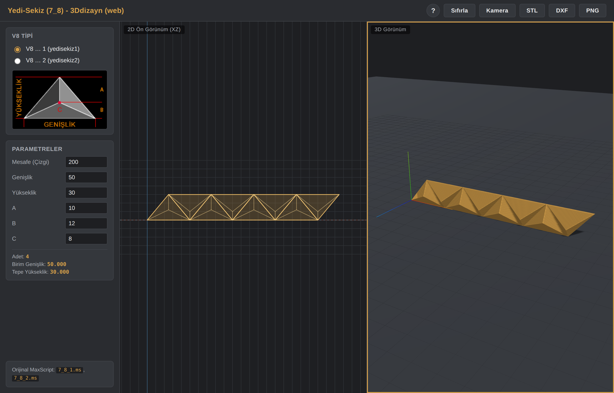

[▶ Aç](https://ahmet3ddd.github.io/ahmetoff/projects/AI_7-8/) · [Kaynak](projects/AI_7-8)

---

## Üretim ve Analiz

Ölçen, denetleyen ve sonucu görselleştiren araçlar.

### AI Light — Geometrik Optik Simülatörü
Mercek, ayna, prizma ve diyaframlarla optik düzenekler kurar; ışın izlerini, görüntü oluşumunu ve tayf ayrışmasını gerçek zamanlı hesaplar. On yedi hazır kurulum içerir (prizma tayfı, akromatik dublet, Kepler teleskobu, bileşik mikroskop…).

**3D Fizik Modu:** İleri modda ışınlar 2B kesitte değil **hacimde** izlenir; Snell ve Fresnel 3B vektörlerle uygulanır. Böylece eğik elemanlarda astigmatizm, yatık prizmada dönen tayf ve perdede iki boyutlu görüntü gibi 2B'de görünmesi imkânsız etkiler ortaya çıkar.

Kırılma **Snell**, yansıma oranları **Fresnel** ile hesaplanır; renk ayrışması için **Cauchy dispersiyonu** ve **Abbe sayısı** kullanılır. **Brewster açısı**, **Airy diski**, difraksiyon sınırı ve büyütme hesapları da yapılır. Sahne PNG, DXF ve STL olarak dışa aktarılır — tasarladığınız merceği 3B baskıya gönderebilirsiniz. Dış bağımlılığı yoktur, çevrimdışı çalışır.

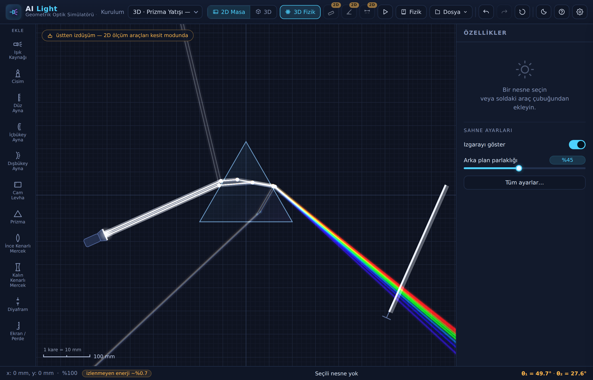

[▶ Aç](https://ahmet3ddd.github.io/ahmetoff/projects/AI_light/) · [Kaynak](projects/AI_light)

### 3D Print Model Kontrol
STL modellerde FDM et kalınlığını ışın tabanlı analizle ölçer; basılamaz (1 hattın altı) ve riskli (2 hattın altı) bölgeleri model üzerinde renklendirir. Eşikler nozzle çapı ve hat genişliğinden otomatik hesaplanır.

Ayrıca **örgü sağlığı taraması** (açık kenar, non-manifold, yön uyumsuzluğu, dejenere/çift yüz, kırıntı parça), tek tuşla **onarım**, **ölçek ve birim düzeltme** (inç/cm/m → mm), ince bölgeleri hedefe kalınlaştıran **yerel revizyon** ve **STL dışa aktarım** içerir.

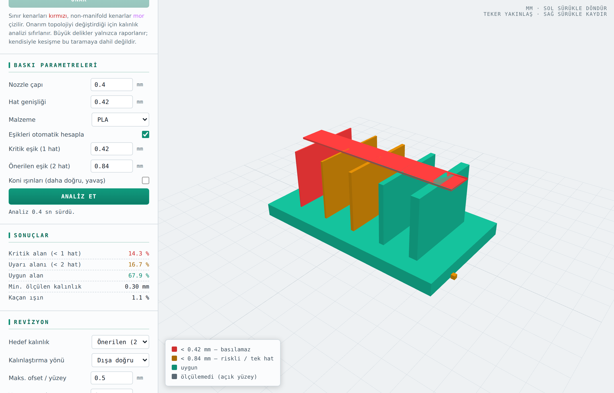

[▶ Aç](https://ahmet3ddd.github.io/ahmetoff/projects/AI_3Dprint_model_kontrol/) · [Kaynak](projects/AI_3Dprint_model_kontrol)

---

## Öğrenme

### Elifbâ — Osmanlıca Öğren
Osmanlı Türkçesini sıfırdan öğreten uygulama. Elifbânın 33 harfinden başlar, gerçek belge ve divan şiiri okumaya kadar gider.

**17 ünite, 73 ders, 13 alıştırma tipi.** Aralıklı tekrar (SRS) sistemi, telaffuz alıştırması, gerçekten puanlayan yazı tahtası ve 280 kelimelik sözlük içerir. Yazı tipleri dâhil her şey uygulamanın içinde — çevrimdışı çalışır.

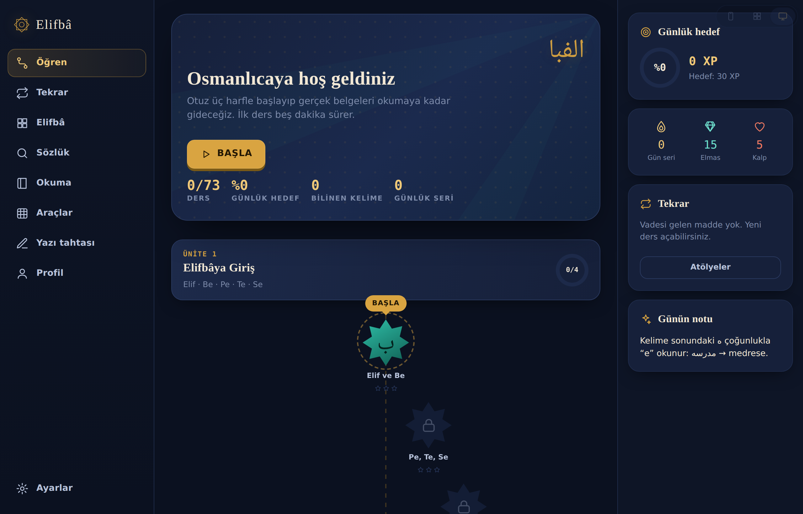

[▶ Aç](https://ahmet3ddd.github.io/ahmetoff/projects/AI_osmanlica/) · [Kaynak](projects/AI_osmanlica)

---

## Yapı

```
ahmetoff/
├── index.html      → Tüm projeleri listeleyen açılış sayfası
├── assets/         → Açılış sayfası ve README görselleri
│   └── demo/       → Her projenin kısa kullanım GIF'i
├── projects/       → Her bağımsız proje kendi klasöründe
│   ├── AI_muk3d_V3/               Mukarnas 3D — güncel sürüm (v3)
│   ├── AI_muk3d_V2/               Mukarnas 3D — önceki sürüm (v2, arşiv)
│   ├── AI_muk3d/                  Mukarnas 3D — ilk sürüm (v1, arşiv)
│   ├── AI_K_muk3d/                Köşe Mukarnas
│   ├── AI_N_muk3d/                Niş Mukarnas
│   ├── AI_Puskul/                 Püskül 3D
│   ├── AI_Kemer/                  Kemerler 3D
│   ├── AI_Revzen/                 Revzen 3D
│   ├── AI_7-8/                    Yedi-Sekiz
│   ├── AI_light/                  AI Light — optik simülatörü
│   ├── AI_3Dprint_model_kontrol/  3D Print Model Kontrol
│   └── AI_osmanlica/              Elifbâ — Osmanlıca Öğren
└── LICENSE         → MIT
```

## Teknoloji

Tümü saf HTML/CSS/JavaScript. Mimari geometri araçları 3B görselleştirme için [Three.js](https://threejs.org) kullanır (CDN üzerinden). Niş Mukarnas, AI Light, 3D Print Model Kontrol ve Elifbâ tamamen kendi kendine yeter; dış bağımlılıkları yoktur ve çevrimdışı çalışırlar (Niş Mukarnas Three.js'i kendi içinde taşır).

Hiçbir projede sunucu tarafı yoktur — veri toplanmaz, hiçbir dosya yüklenmez.

## Lisans

Bu depodaki içerik [MIT](LICENSE) lisansı ile sunulmuştur. Elifbâ uygulamasının içerdiği yazı tiplerinin kendi lisansları için `projects/AI_osmanlica/LISANSLAR.md` dosyasına bakın.
