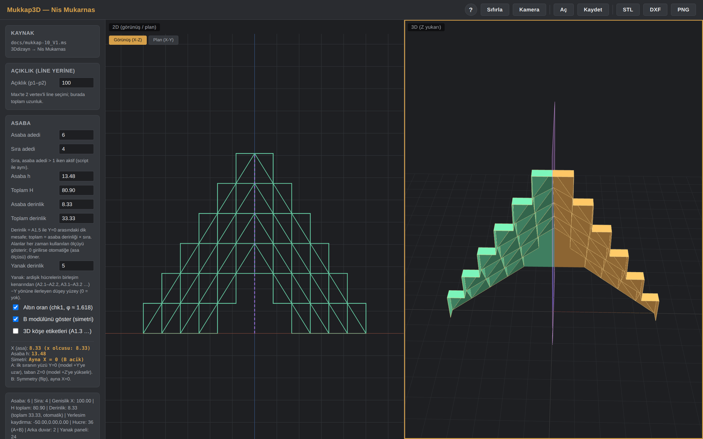

# Niş Mukarnas

Niş (kavsara) mukarnaslarını açıklık, asaba ve sıra parametreleriyle 2B ve 3B kurgulayan, tarayıcıda çalışan bir tasarım aracı.

**▶ Canlı demo:** https://ahmet3ddd.github.io/ahmetoff/projects/AI_N_muk3d/



## Ne yapar

Bir niş mukarnasının kurgusu tek bir açıklık ölçüsüyle başlar: p1–p2 arası uzunluk modelin toplam genişliğidir. Asaba adedi ve sıra adedi girildiğinde hücreler kademelenir, X = 0 düzleminde aynalanan simetri modülüyle birlikte form tamamlanır. Her değişiklikte 2B görünüş, 2B plan ve 3B model eş zamanlı yeniden üretilir.

**Ölçü mantığı çift yönlüdür.** Yükseklikte *asaba h* ile *toplam H*, derinlikte *asaba derinlik* ile *toplam derinlik* birbirine bağlıdır; hangisini elle girerseniz o belirleyici olur, diğeri ondan türetilir. Alanlar her zaman çizimde fiilen kullanılan ölçüyü gösterir. Derinlik alanına **0** girilirse otomatiğe döner ve asa ölçüsünü izler.

**Altın oran.** Açıkken asaba yüksekliği asa ölçüsünün φ ≈ 1,618 katı olur ve yükseklik alanları kilitlenir. Kapatıldığında elle girdiğiniz değerler geri gelir — oran açıkken saklanır, kaybolmaz.

**Otomatik yüzeyler.** Sıra adedi asaba adedinden az olduğunda son sıranın arkasında kalan açıklık tek parça bir duvarla kapatılır. Yanak derinliği verildiğinde her hücrenin ön yüz üçgeninin iki dik kenarı −Y yönünde süpürülerek düşey yanak yüzeyleri üretilir. Aynaya tam oturan yüzeyler çizilmez, böylece üst üste binen çift yüzey oluşmaz.

**Dışa aktarım.** **STL** (3B baskı ve CNC), **DXF** ve **PNG**. DXF üç katman üretir: `MUK_3D` (3DFACE katı geometri), `MUK_ELEV` (görünüş) ve `MUK_PLAN` (plan, görünüşün altına yerleşir). Tüm parametreler `.json` olarak kaydedilip geri yüklenebilir.

## Kullanım

Kurulum gerekmez. Canlı demoyu açın ya da `index.html` dosyasını tarayıcıda açın. Three.js uygulamanın içinde geldiği için internet bağlantısı gerekmez.

- **Açıklık** — modelin X− ve X+ uçları arasındaki toplam genişlik
- **Asaba / Sıra** — sıra adedi asaba adedini aşamaz
- **B modülü** — simetri kopyası; ayna düzlemi X = 0, sahnede mor düzlemle gösterilir
- **3D köşe etiketleri** — A1.3 gibi köşe numaralarını 3B'de gösterir (varsayılan kapalı)
- **Kamera** düğmesi modeli çerçeveye oturtur; **Sıfırla** parametreleri başlangıç değerlerine döndürür

Sol alttaki durum satırında asaba/sıra, modelin X genişliği, toplam yükseklik, kullanılan derinlik, hücre sayısı ve varsa arka duvar / yanak paneli sayısı okunur.

## Sahnedeki yerleşim

İlk sıranın yüzü **Y = 0** düzlemindedir, model **+Y** yönüne uzar. Taban **Z = 0** zeminine oturur, model **+Z** yönüne yükselir; asaba ve sıra arttıkça aşağı sarkmaz. Simetri düzlemi **X = 0**; model açıklığın yarısı kadar iki yana yayılır. 2B görünüşte düşey eksen Z (mavi), yatay eksen X (kırmızı); planda düşey eksen Y (yeşil) — eksen renkleri 3B göstergesiyle aynıdır.

## Dizin yapısı

```
index.html              Arayüz
css/style.css           Görsel dil
js/
  main.js               Ana uygulama ve parametre mantığı
  mukarnas-geom.js      Hücre, yanak ve arka duvar geometrisi
  viewer-2d.js          2B görünüş ve plan
  viewer-3d.js          3B görünüm
  project-io.js         JSON kaydet / aç
  export-stl.js / export-dxf.js / export-png.js
vendor/                 Three.js r147 + OrbitControls
```

## Teknoloji

Saf HTML/CSS/JavaScript + [Three.js](https://threejs.org) r147. Three.js uygulamanın içinde gelir; CDN veya ağ isteği yoktur, çevrimdışı çalışır.

Geometri, 3ds Max için yazılmış `mukkap-10_V1.ms` MaxScript'inin web'e taşınmış hâlidir; spinner mantığı ve ölçü ilişkileri özgün betikle aynı tutulmuştur.

---

← [Tüm projeler](../../)
