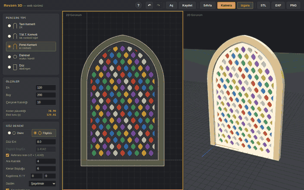

# Revzen 3D

Revzen-i menkûş — alçı ya da taş bir levhaya açılan gözlerin renkli camlarla doldurulduğu Osmanlı pencerelerini parametrik olarak üreten, tarayıcıda çalışan bir tasarım aracı.

**▶ Canlı demo:** https://ahmet3ddd.github.io/ahmetoff/projects/AI_Revzen/



## Ne yapar

Pencere tipini, ölçüleri ve göz desenini verirsiniz; araç kemer profilini çizer, gözleri yerleştirir ve 2B vektör ile 3B katı modeli eş zamanlı üretir. Her parametre değişiminde her iki görünüm de yeniden hesaplanır.

**Beş pencere tipi.** Her biri kendi geometrisiyle kurulur, hazır şablon değildir:

| Tip | Kurgu | Kemer yüksekliği |
|---|---|---|
| **Tam Kemerli (DK)** | Yarım daire, `r = En/2` | `En/2` |
| **T.M.T. Kemerli** | Tek merkezli teğet: 0–60° ve 120–180° yayları, uçlardan tepeye teğet doğrular | `En × 0,57735` |
| **Penci Kemerli** | İki merkezli sivri kemer; merkezler eksenden ±`En/10` kaydırılır, `r = 0,6 × En` | `En × 0,59161` |
| **Dairesel** | Oculus — En = Boy ise daire, değilse elips | — |
| **Düz** | Kemersiz dikdörtgen | — |

**İki göz formu.** *Daire* klasik yuvarlak gözdür. *Filgözü* ise sivri uçlu badem formu — kurgusu T.M.T. kemerin üstte ve altta aynalanmış hâlidir: merkezde `r = En/2` yarıçaplı bir yay, uçlara teğet doğrular. Geçiş açısı `t₀ = arcsin(En/Boy)`.

Referans oran **√2 ≈ 1,4142**'dir ve bu ölçülmüş değil, *türetilmiş* bir sayıdır: referans çizimde teğet noktası tam **45°**'te durur, dolayısıyla `Boy/En = 1/sin 45° = √2`. Aynı kurgudan teğet parçasının uzunluğu da yarıçapa eşit çıkar (`√((Boy/2)² − (En/2)²) = En/2`). Kapalı form olduğu için yuvarlama payı yoktur. *Referans oran* kutusunu kaldırıp kendi oranınızı deneyebilirsiniz.

**Desen çözümü.** Yatay adım göz eni ile ara kalınlığın toplamıdır; satır adımı ise *çözülerek* bulunur — çapraz komşuyla arada da tam olarak aynı kalınlık kalacak şekilde. Yani alçı bandı her yönde eşit kalınlıktadır. Şaşırtmalı, sık şaşırtmalı ve düz dizilim seçenekleri, desen kaydırma (X/Y) ve kenarlarda kesme vardır. Alt şeritte göz sayısı, kaç tanesinin kenardan kesildiği ve adım ölçüleri canlı okunur.

**3B ve dışa aktarım.** Çerçeve ve panel derinlikleri ayrı verilir. Sahne **STL** (3B baskı / CNC), **DXF** (CAD) ve **PNG** olarak dışa aktarılır; proje `.json` olarak kaydedilip geri yüklenir. Renkli cam gösterimi açılıp kapatılabilir.

## Kullanım

Kurulum gerekmez. Canlı demoyu açın ya da `index.html` dosyasını tarayıcıda açın (3B için internet bağlantısı gerekir — Three.js CDN'den yüklenir).

- **En / Boy** — pencere boşluğunun toplam ölçüleri; orijin sol alt köşededir. Kemerli tiplerde Boy, kemer yüksekliğinden küçük olamaz
- **Çerçeve Kalınlığı** — konturu dışa doğru öteler; 0 verilirse yalnız kontur çizilir
- **Ara Kalınlık / Kenar Boşluğu** — gözler arasındaki ve kenardaki alçı bandı
- **Izgara** düğmesi zemin ızgarasını, **Kamera** düğmesi 3B görünümü nesneye oturtur
- Kısayollar ve ayrıntılı anlatım için sağ üstteki **?** düğmesi

## Kimler için

Restorasyon ve rölöve çalışmaları, mimarlık eğitimi, geleneksel bezeme araştırmaları ve revzen desenini 3B baskı ya da CNC ile üretmek isteyenler.

## Değişiklikler

**1 Eylül 2026 — filgözü oranı düzeltildi.** Referans oran, çizimden kaba piksel okumasıyla alınan **1,43** yerine kapalı form değeri **√2 ≈ 1,4142** oldu (%1,1'lik sapma giderildi). Geçiş açısı 44,43° yerine tam 45°. Bu sürümden önce kaydettiğiniz projeler kendi oran değerleriyle açılmaya devam eder; referansa dönmek için *Referans oran* kutusunu yeniden işaretleyin.

## Dizin yapısı

```
index.html              Arayüz
css/style.css           Görsel dil
js/
  revzen-geometry.js    Kemer profilleri ve göz yerleşimi
  revzen-mesh.js        3B katı gövde üretimi
  viewer-2d.js          2B vektör görünüm
  viewer-3d.js          3B görünüm
  proje-io.js           JSON kaydet / aç
  export-stl.js / export-dxf.js / export-png.js
assets/                 Referans görsel
```

## Teknoloji

Saf HTML/CSS/JavaScript + [Three.js](https://threejs.org) r147.

Geometri, 3ds Max için yazılmış `revzen_DK-v1.ms`, `revzen_TMT-v1.ms` ve `revzen_PK-v1.ms` MaxScript'lerinin web'e taşınmış hâlidir.

---

← [Tüm projeler](../../)
