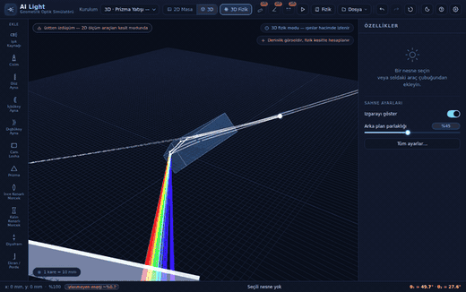

# AI Light — Geometrik Optik Simülatörü

Mercek, ayna, prizma ve diyaframlarla optik düzenekler kuran; ışın izlerini, görüntü oluşumunu ve tayf ayrışmasını gerçek zamanlı hesaplayan, tarayıcıda çalışan bir simülatör. **Sürüm 2.0**

**▶ Canlı demo:** https://ahmet3ddd.github.io/ahmetoff/projects/AI_light/

## Ne yapar

Sahneye optik eleman yerleştirirsiniz — ışık kaynağı, cisim, düz/içbükey/dışbükey ayna, cam levha, prizma, ince ve kalın kenarlı mercek, diyafram, ekran — ve ışınlar anında izlenir. Elemanları sürükleyip döndürdükçe hesap yeniden yapılır; alt şeritte geliş ve kırılma açıları (θ₁, θ₂) canlı okunur.

**Hazır kurulumlar.** Boş sahneden başlamak zorunda değilsiniz; on yedi hazır düzenek var: prizmada minimum sapma, beyaz ışık tayfı, ince/kalın kenarlı mercek, akromatik dublet, cam levha, içbükey ayna, mum ve mercek (gerçek görüntü), büyüteç (sanal görüntü), içbükey aynada görüntü, Kepler teleskobu, bileşik mikroskop ve 3D fizik modunu gösteren dört düzenek.

**Fizik.** Kırılma Snell yasasıyla, yansıma oranları Fresnel denklemleriyle hesaplanır. Renk ayrışması için Cauchy dispersiyonu ve Abbe sayısı kullanılır; kromatik sapma ve akromatik dublet davranışı bu yüzden gerçekçi çıkar. Ayrıca Brewster açısı, Airy diski ve difraksiyon sınırı, sayısal açıklık ve büyütme hesapları yapılır — yani araç yalnız çizmiyor, ölçüyor.

**2B ve 3B.** Düzeneği tepeden 2B masa görünümünde kurar, aynı sahneyi 3B olarak da inceleyebilirsiniz.

**3D Fizik Modu (2.0 ile geldi).** Varsayılan modda fizik, optik masanın 2B kesitinde hesaplanır. İleri modda ise ışınlar **hacimde** izlenir: her yüzey — küre parçası, düzlem, silindir yanağı, üçgen ağ — 3B'de kesilir; Snell yasası ve Fresnel katsayıları 3B vektörlerle uygulanır. Böylece 2B'de görünmesi mümkün olmayan etkiler gerçek izlemeden çıkar: **eğik elemanlarda astigmatizm**, **yatık prizmada dönen tayf**, **perdede iki boyutlu görüntü**. Üst çubuktaki *3D Fizik* düğmesiyle açılır; mod açıkken 2B tuval üstten izdüşüm olarak çalışmayı sürdürür. Bu modu gösteren dört hazır kurulum eklendi (eğik levha ve eğik mercek astigmatizmi, F harfi 2B görüntü, prizma yatışı).

**Dışa aktarım.** Sahne **PNG** (koyu veya beyaz zemin), **DXF** (R12) ve **STL** (ASCII) olarak dışa aktarılır; STL'de mercekler dönel gövde ya da ekstrüzyon olarak üretilebildiği için tasarladığınız merceği 3B baskıya gönderebilirsiniz. Düzenekler JSON olarak kaydedilip yeniden açılabilir.

## Kullanım

Kurulum gerekmez. `index.html` dosyasını tarayıcıda aç. Üstteki **Kurulum** listesinden bir hazır düzenek seçmek en hızlı başlangıç; sonra elemanları sürükleyerek kendi sahneni kurabilirsin.

Sol araç çubuğundan eleman eklenir, seçilen elemanın ayarları sağdaki **Özellikler** panelinde açılır. Klavye kısayolları ve ayrıntılı kılavuz için sağ üstteki **?** düğmesine bak.

Uygulama tek bir HTML dosyasıdır; dış bağlantısı, CDN'i veya ağ isteği yoktur — internet olmadan da çalışır.

## Kimler için

Fizik ve optik dersleri (ışın optiği, görüntü oluşumu, dispersiyon), optik tasarıma giriş, ve merceğini 3B baskıyla üretmek isteyenler.

## Teknoloji

Tek HTML dosyası — saf HTML/CSS/JavaScript. Işın izleme, fizik hesapları ve dışa aktarma biçimleri tamamen uygulamanın içinde yazılmıştır; hiçbir üçüncü taraf kütüphanesi kullanılmaz.

---

← [Tüm projeler](../../)
