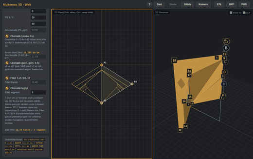

# Mukarnas 3D — v2 (önceki sürüm)

> **Bu, aracın önceki sürümüdür.** Güncel sürüm için: **[Mukarnas 3D v3](../AI_muk3d_V3)** → [canlı demo](https://ahmet3ddd.github.io/ahmetoff/projects/AI_muk3d_V3/)
>
> v3, **Yaprak** tipinde Düzenleme modundaki A–F yükseklik ayarlarının yanlış köşeleri taşıması sorununu düzeltiyor. Bu sürümde o hata var.

Mukarnas (sarkıt tavan süslemesi) tiplerini parametrik olarak 2B ve 3B modelleyen, tarayıcıda çalışan tasarım aracı.

**▶ Canlı demo:** https://ahmet3ddd.github.io/ahmetoff/projects/AI_muk3d_V2/

## v2'de yeni: Fillet (kenar yuvarlatma)

7–8 ve 16–17 kenarları yay şeklinde yuvarlanabiliyor. Yay her iki uçta yan duvarlara yatırılıyor ve komşu yüzeyler yeniden örülüyor — yani yuvarlatma sonradan eklenen bir görsel efekt değil, mesh'in kendisi yeniden inşa ediliyor.

- **Otomatik boyut** — fillet yarıçapı güncel geometriden hesaplanır, elle de girilebilir
- **Segment sayısı** — yayın çözünürlüğünü belirler (1 = düz pah, artırdıkça yay yumuşar)
- **Düzenlemeye dayanıklı** — A–F ve BOY düzenlemelerinden sonra fillet güncel geometriye göre yeniden hesaplanır, yaptığınız düzenlemeleri bozmaz

Badem tipi için tasarlandı; referans olarak `badem.STL` alındı.

## Özellikler

- Mukarnas tipleri: **Badem**, **Yaprak**, **Fitil**, **Kaz Ayağı**
- Çalışma modları: **Çizim** ve **Düzenleme**
- Parça modları: tam (simetri), tam (asimetrik), yarım sol/sağ
- Otomatik asaba (altın oran) hesabı, plan üçgeni (P1-P2-P3) girişi
- Eş zamanlı 2B plan ve 3B görünüm, köşe/yüz numaralandırma
- Geri / Yinele desteği
- **DXF**, **STL** ve **PNG** dışa aktarım

## Kullanım

Kurulum gerekmez. `index.html` dosyasını tarayıcıda aç (3B için internet bağlantısı gerekir — Three.js CDN'den yüklenir).

## Sürüm geçmişi

| Sürüm | Klasör | Durum |
|---|---|---|
| **v3** | [`AI_muk3d_V3`](../AI_muk3d_V3) | Güncel — Yaprak düzenleme düzeltmesi |
| v2 | `AI_muk3d_V2` | Bu sürüm — fillet desteği eklendi |
| v1 | [`AI_muk3d`](../AI_muk3d) | Arşiv — fillet öncesi hâli |

v1'i denemek isterseniz: [canlı demo](https://ahmet3ddd.github.io/ahmetoff/projects/AI_muk3d/)

## Teknoloji

Saf HTML/CSS/JavaScript + [Three.js](https://threejs.org) r147.

---

← [Tüm projeler](../../) · [Güncel sürüme geç (v3)](../AI_muk3d_V3)
